# iSee 桌面端功能巡览：截图 + 实现分析 + 官网复用评估

调查时间：2026-10-25；截图于 2026-10-26 重拍（浅色主题）。对象：本地 dev 栈（`pnpm dev:local`）中运行中的 iSee 桌面端（pid 43951，测试账号 verify-a），源码 `/Users/fanbingbing/Documents/project/isee`。

截图由 cua-driver 对**正在运行的真实客户端**逐面截图得到，已随本文档一起放进 `public/features/`（webp，1366×854 / 设置页 1280×1120）。没有任何一张是设计稿或合成图。会话列表里的真人昵称、设备 ID 与账号字段已做遮挡。

## 1. 先看架构，再看功能

所有功能共用一套四层结构，理解它之后每个功能的差异只剩「数据从哪来」。

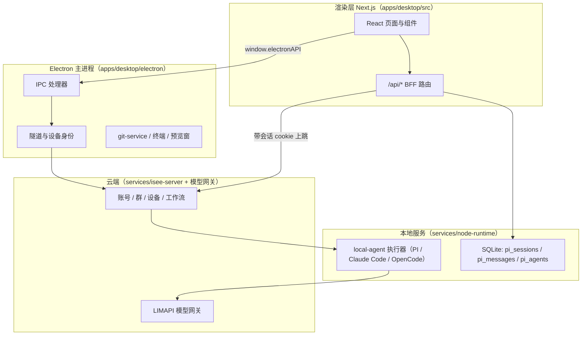

四个必须知道的事实：

1. **两种启动形态**。开发态用 `utilityProcess.fork` 拉一个 Next dev server（首选 5001）；打包态是静态导出 + `isee-app://` 自定义协议 + 进程内 BFF，**不监听任何端口**（`electron/main.ts`、`electron/bff/zero-port-dispatch.ts`）。所以渲染层跳路由不能靠 `router.replace`，桌面壳里用 `history.replaceState`（`src/lib/chat/session-route.ts`）。
2. **会话 cookie + 双后端**。`/api/pi/*` 由本地 node-runtime 应答并直接读写 SQLite；`/api/cloud/*`、`/api/agent/*` 带 HttpOnly cookie 上跳云端 Java。401 由 `cloudFetch` 全局拦截并切回登录窗。
3. **设备身份是本机与云端的桥**。隧道进程用机器根 `config.json` 里的 `deviceId` + `deviceSecret` 注册成一台设备，云端据此把「在这个 Agent 上跑一轮」下发回这台机器（`electron/device-association.ts`、`electron/tunnel-installer.ts`）。
4. **特权能力全走 IPC**。渲染层只能通过 preload 暴露的 `window.electronAPI` 触达文件、git、终端、截图、语音、窗口（`electron/ipc/channels.ts` 是唯一通道清单）。

---

## 2. 主界面框架：左侧轨 + 会话列 + 主工作区 + 右侧面板

**用户看到什么**：一条仿微信窄轨（消息/通讯录切换、未读总数、自己头像、底部设置入口）→ 会话列表（搜索框 + 按最近活跃排序 + 置顶）→ 主工作区（标题栏、状态胶囊、消息流、输入框）→ 可展开的右侧面板。

**渲染层**：`ChatShellLayout` 是纯 slot 组件（`components/chat/chat-shell-layout.tsx`），装配在 `app/(main)/_components/friend-chat-shell.tsx`；壳级状态中枢 `hooks/use-chat-shell-frame.ts`。主工作区按会话类型四选一（通讯录详情 / 空闲首页 / 真人单聊 / 群聊 / Agent 1:1）。

**本地能力**：窗口最小化/最大化/关闭走 `window:*` IPC；面板宽度持久化在本地。

**远端**：无。这是纯渲染壳。

**要点**：流式 token 会让整棵树重渲染，composer 必须 `memo`，回调用 ref 稳定引用；`human_dm` 与 `shared_group` 切换要 `key={sessionId}` 强制重挂，否则旧会话消息残留。

---

## 3. Agent 1:1 对话（Markdown / 表格 / 代码块 / 引用回复）

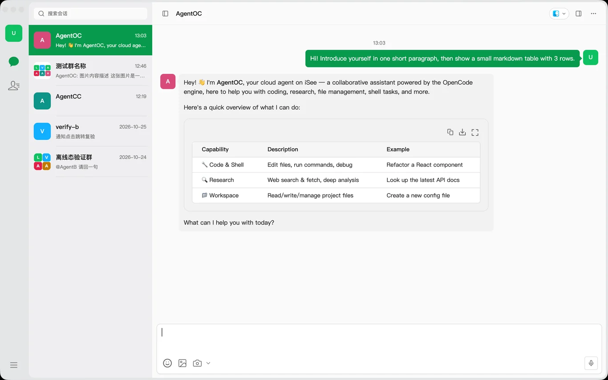

**用户看到什么**：微信式气泡；Markdown 渲染标题、表格（带复制/下载/全屏三个按钮）、代码块（行号、复制、语言徽标）；悬浮出「复制 / 回复」；输入框上方有引用卡片；流式中输入框变停止按钮。

**渲染层**：`components/chat/v2/chat-message-surface.tsx` 协调列表与滚动（`useChatScrollController`：吸底跟随 + 阅读锚点）；`chat-message-list.tsx` **刻意不做虚拟化**——窗口本身有上限，虚拟列表在顶部插入历史时会出空白帧和跳动；正文用 Streamdown（`components/ai-elements/message.tsx`），Mermaid 围栏直接渲染成图，失败回落代码面。

**本地能力**：截图按钮走 `screenshot:start-capture`（结果只进系统剪贴板，不上传）；附件走 `dialog:openFile`；语音走 `voice-input:*` 一组通道。

**远端**：发送链 `executeLocalSend` → `POST /api/agent/v1/sessions/query`（BFF 中继到云端 `/api/v2/query`，由模型网关取 key）；重试沿用原 `userMessageUuid` 保证服务端幂等。

**要点**：会话区只显示最终正文，流式占位气泡不上屏，进度由标题栏胶囊承载。

---

## 4. 群聊与多 Agent 协作

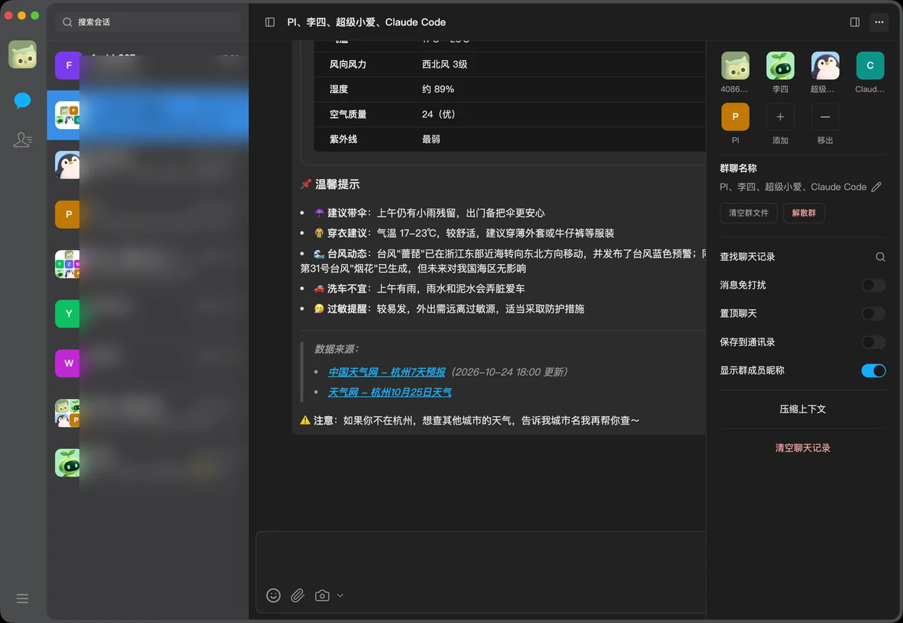

**用户看到什么**：成员合成九宫格头像；`@` 弹 Agent 候选（末尾固定「全体」）；发送后标题栏出现「群协作」胶囊，随后每个在途 Agent 一个「运行中 · 名字」胶囊；输入框上方给出「终止」；右侧面板多出群私信/群文件/操作记录。

**渲染层**：`hooks/use-group-chat.ts`（发送 + 触发评估）、`app/(main)/_components/use-group-task-chips.tsx`（胶囊派生）、`lib/group/group-execution-store.ts`（WS 帧即时权威 + 5s REST 轮询补齐，用序号水位裁决迟到快照）。

**本地能力**：群任务执行器跑在**主进程**（`electron/group-task-runtime.ts`）：事件驱动认领 + 60s 轮询兜底 + 10s 心跳；设备侧 local-agent 解析 `<机器根>/group-agents/<群>/<Agent>` 作为工作目录。

**远端**：`POST /api/cloud/group/:id/triggers` → Java 触发闸（速率、预算、`MAX_RELAY_HOPS=3`、同消息幂等）→ Node `group-bridge` 建工作流 → 规划器产出任务图（`maxInFlight=4`、`maxNodes=32`）→ 云端 `/api/v2/query` 把节点派到设备。

**要点**：群调度帧必须先于 Agent 帧到达，否则会出现「Agent 气泡先出、胶囊后出」的状态说谎；重进群时状态帧不重放，必须靠 `workflows/active` 与 `tasks/in-flight` 两条 REST 对账。

---

## 5. 聊天信息抽屉（免打扰 / 置顶 / 查找记录 / 压缩上下文）

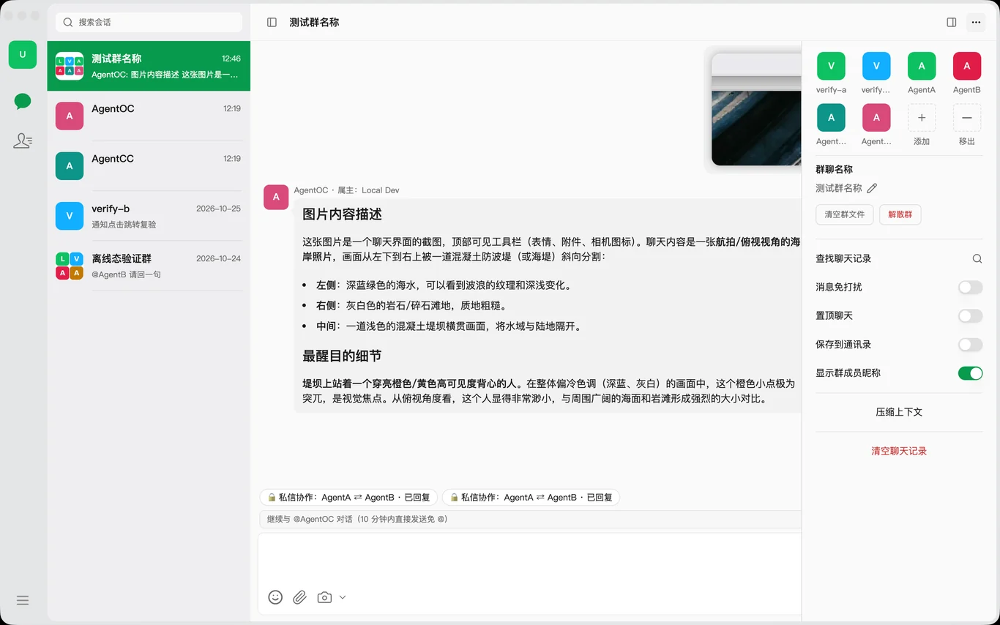

**用户看到什么**：标题栏「⋯」拉出抽屉：Agent 头像格、消息免打扰、置顶聊天、查找聊天记录、压缩上下文、清空聊天记录；群聊额外有群成员、保存到通讯录、显示成员昵称。

**渲染层**：`components/chat/chat-context-panel.tsx`。

**本地能力**：偏好写本地库经 `PATCH /api/pi/sessions/:id`；「查找聊天记录」开**独立窗口**（`history:open-window`，单例、可回跳定位）。

**远端**：「压缩上下文」调 `cloudManualCompact(sessionId)`——服务端只置标记，在下一轮起点执行，不在本地做摘要。

**群聊额外内容**：同一抽屉下半部分是群成员网格、添加成员、邀请码、群名编辑、清空群文件与解散群。成员增删走 `/api/group/{id}/members/{type}/{id}`（只有群主能删），邀请码 `/invite-code` 与 `/invite/{code}/join`；新成员只能拉到自己入群之后的消息，可见起点由成员区间表 `im_group_member_interval` 记录。

**要点**：清空在共享群里是「只清自己视图 + 名下 Agent 上下文」，不是删群消息。

---

## 6. 会话搜索

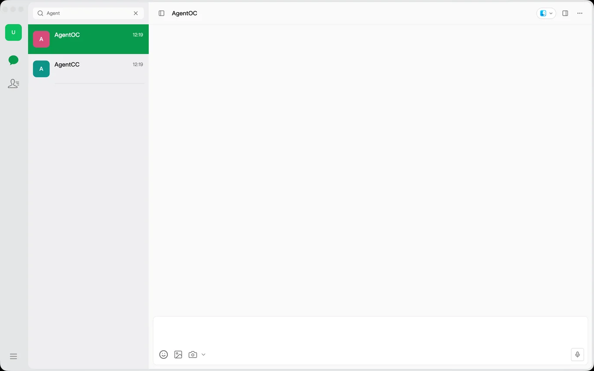

**用户看到什么**：点搜索图标就地变输入框，实时过滤会话名；无命中显示「无匹配结果」+「清除搜索」；Esc 第一次清空、第二次收起。

**渲染层**：`components/chat/friend-l1-list.tsx`——过滤是纯客户端内存 `name.toLowerCase().includes(q)`，不发请求。

**要点**：只按名称过滤，不检索消息正文（正文检索在「查找聊天记录」窗口里，走两层直扫 `pi_messages` 的索引路由）。

---

## 7. 通讯录（Agent / 好友 / 群聊三组）

**用户看到什么**：三段分组（群聊、好友按拼音首字母、智能体），折叠状态持久化；点 Agent 开资料卡，点好友开信息面板，点群直接进会话。

**渲染层**：`components/chat/friend-contacts-rail.tsx`（拼音分组 + 折叠持久化）。

**远端**：好友列表 `GET /api/cloud/im/friends` → Java；首进通讯录拉一次并缓存，之后只由「增删好友」事件与腾讯 IM 关系链变更事件触发刷新。

---

## 8. 添加 Agent / 添加好友 / 新建群聊

**用户看到什么**：通讯录标题栏「+」弹出三项：添加 Agent（进 Agent 市场）、添加好友（邮箱/手机号查找）、新建群聊（一次勾齐 Agent 与真人好友）。

**渲染层**：`components/chat/contacts-add-menu.tsx`、`create-group-dialog.tsx`。

**要点**：建群必须一次带齐成员——分两步加人会让合成头像只画一格；建群后按 1/2/3/4 秒的预算轮询群详情等头像生成。

---

## 9. Agent 资料卡

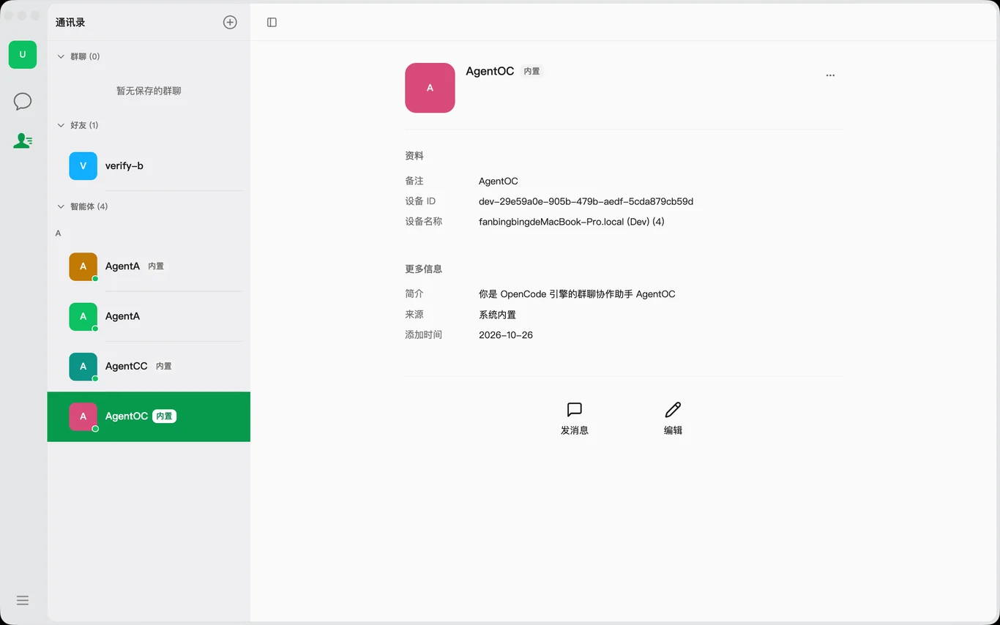

**用户看到什么**：仿微信资料页：头像、名称（备注优先）、资料、更多信息、发消息 / 编辑 / ⋯ 删除；内置 Agent 且绑定在其他设备上的删除项置灰。

**渲染层**：`components/chat/pi-agent-profile-card.tsx`。

**要点**：刻意不渲染 systemPrompt、模型清单、工具清单与 UUID——这些属于实现细节，不进用户视野。

---

## 10. Agent 市场（云端网格 + 常驻内置区）

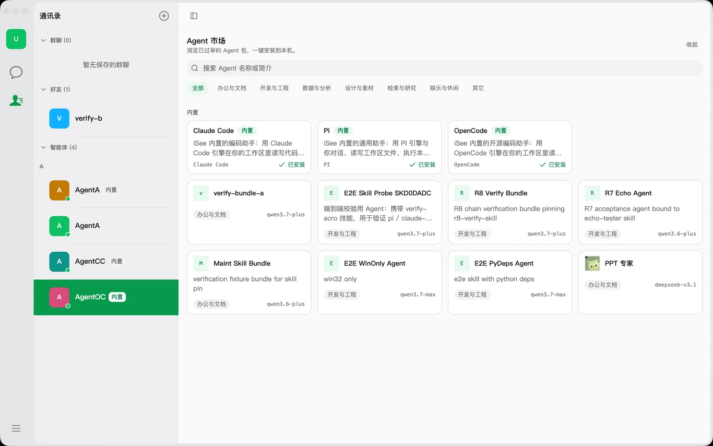

**用户看到什么**：右面板整块变市场：搜索、分组 chips、卡片网格；「内置」区始终渲染（Claude Code / PI / OpenCode，装过显示「已安装」）；离线时云端网格换成提示、内置区仍在但安装禁用。

**渲染层**：`components/agent-market/agent-market-panel.tsx`，详情覆盖层 `agent-market-detail-overlay.tsx`。

**远端**：列表 `GET /api/cloud/agents`（只有 APPROVED 出网格）；引擎清单 `GET /api/cloud/v2/engines` 决定内置卡的显隐——这是服务端的 kill switch。

**安装链（六步，每步可单独失败）**：`preflight → create → skills → materialize → deps → mirror`。create 由云端经隧道在设备上建工作目录并回执 `agentId/workDir/engine`；materialize 从 Java 回读钉版 downloadUrl 下载 zip（32MB 上限、30s 超时），校验全量内容哈希后 rename 成只读副本；mirror 写本地 `pi_agents` 镜像行。create 之后任一步失败都按「先删文件、再删 Agent」补偿。

**要点**：安装失败必须把阶段名与真实原因展示出来。历史事故正是 `catch {}` 把 409 `DEVICE_DIR_UNAVAILABLE` 吞成了「安装失败（创建 Agent），请重试」。

---

## 11. 群内 Agent 私信（只读回放 + 授权公开）

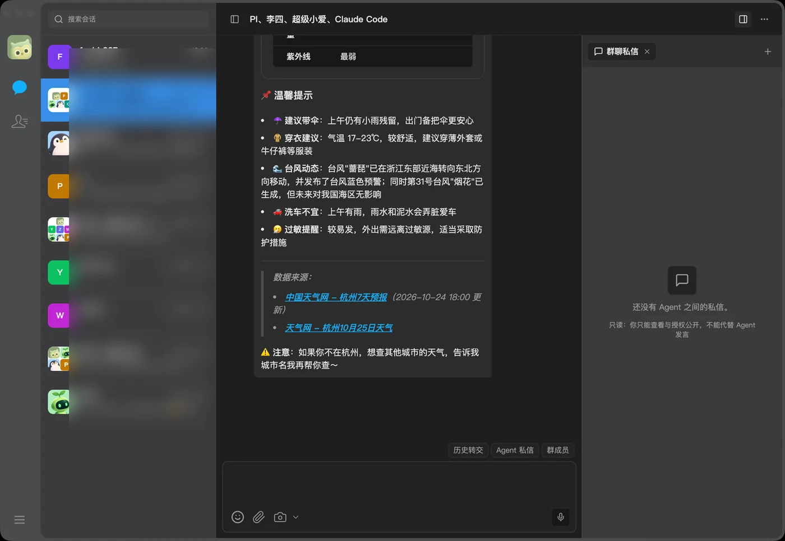

**用户看到什么**：右侧「群聊私信」tab：线程列表（全部/进行中/已完成/异常）→ 详情只读、无输入框；唯一动作是「授权公开」某条成果（带确认）；公屏上有私信回执胶囊，可点击直达线程。

**渲染层**：`group-private-threads-panel.tsx`、`group-private-thread-detail.tsx`、回执胶囊 `group-action-bars.tsx`。

**要点**：Agent 之间的私信默认不进公屏。要公开必须显式授权，且去向由服务端固定——私信成果回原线程，公开走 authorize，客户端不能自行改路由。

---

## 12. 右侧工作区面板（目录 / 终端 / Git / 浏览器）

> 本节没有独立截图。右栏「目录」tab 的形状可以在第 6 节那张截图（`05-session-search.webp`）的右侧看到：一个 `.isee` 根节点、刷新按钮、关闭标签；「终端 / Git」在这个会话里开不出来——`resolveAddMenuKinds` 要求 `hasGitWorkspace` 为真，而账号下这个 Agent 的目录不是 git 仓库。以下终端、Git 与离线行为来自源码与 IPC 通道清单，非截图证据。

**用户看到什么**：右栏 tab 组：目录树、文件预览、终端、Git、浏览器、差异对比；无 tab 时给空态引导 + 「+」菜单。

**渲染层**：`components/dir-tree/right-panel.tsx`。关键设计是**持久层**：`web`（webview）、`terminal`（xterm）、`explorer` 三类 tab 始终挂载，只切可见性，所以切 tab 不丢浏览器历史、终端会话与树展开态。

**本地能力**：本机文件读走 `GET /api/files`，git 走 39 条 `git:*` IPC，终端打包态必须走 `cloud-ws:*` IPC（零端口没有本地 WS 代理）。

**远端**：远程设备上的目录/文件走 `POST /api/cloud/local-agents/:agentId/file/list|read`，穿透到在线设备守护进程；设备离线时前端直接不发请求，显示离线态而不是转圈。

**要点**：「+」菜单的项目是算出来的（`panel-add-menu-kinds.ts`）：共享群只给群私信/群文件/操作记录/浏览器；设备离线只给浏览器；有工作区才给目录/终端/Git。

---

## 13. Git 面板

> 本节没有截图。这个账号当前会话的右栏「+」实测只列出「目录」一项（`resolveAddMenuKinds` 里 `hasGitWorkspace` 为假、`canOfferTerminal` 也不成立），所以 Git 与终端 tab 都开不出来。以下内容来自源码与 IPC 通道清单，非截图证据。

**用户看到什么**：分支与 upstream ahead/behind、搜索/刷新、stash、`.gitignore` 编辑、创建 MR；冲突横幅带「解决冲突」；四个分区：更改、已暂存、未跟踪、已提交（含提交图泳道）；行内 diff 直接展开在被点行下方；底部提交框带 ✨ 生成提交信息。

**本地能力**：`git-service.ts` 纯 `spawn("git")`，配三条硬规则：子进程环境白名单（丢弃 `GIT_DIR` 等重定向变量）、路径收敛到工作区（拒绝 `..`/越界）、**仓库级写互斥**——第二笔写立即返回 `REPOSITORY_BUSY`，不排队不重放；多步复合写（提交并推送、stash 后切分支）在同一把锁内完成。

**远端**：远程设备上的 git 走 `exec-sync`（读）与 `git/write`（写，白名单闸门），渲染侧先收敛路径参数；结果可能是 `unknown`（隧道断/超时），不自动重试。

**要点**：AI 提交信息先读完整 staged patch（截断或为空直接失败），再调云端一次性生成，不重试。

---

## 14. 设置：通用（外观 / 主题色 / 字号 / 语言 / 压缩 / 发送策略）

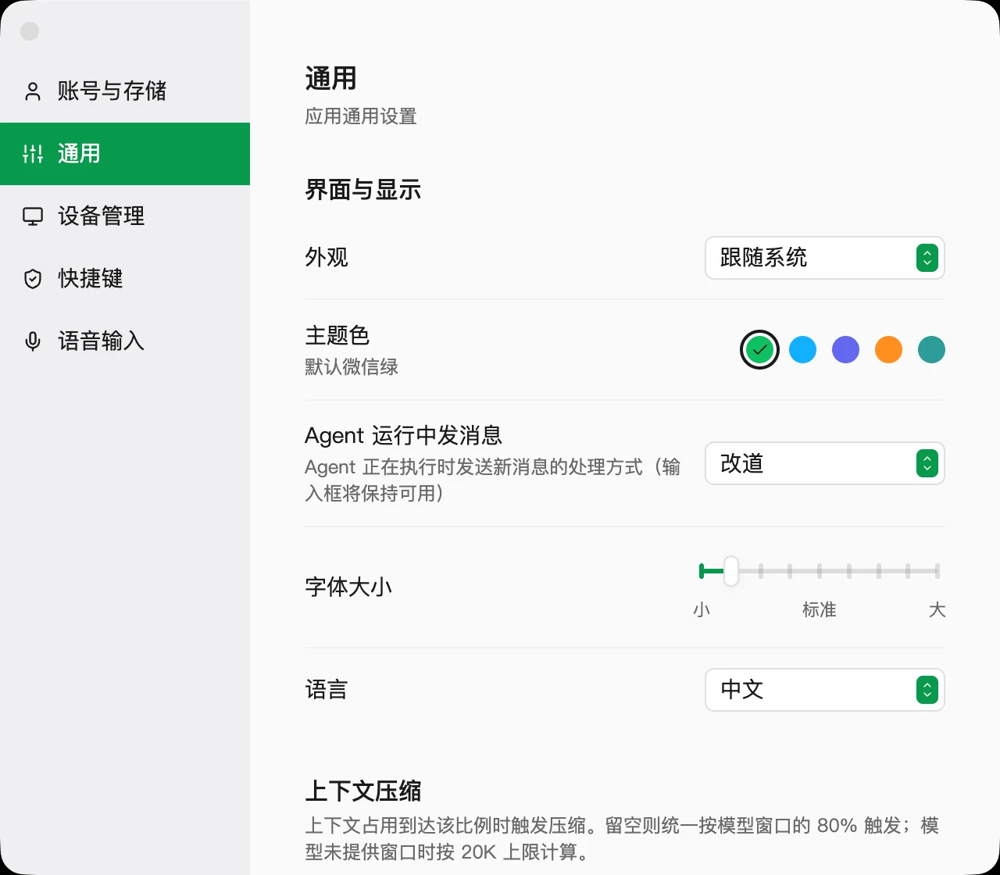

**用户看到什么**：外观（跟随系统/浅色/深色）、主题色 5 个色点、运行中发送（插队 steer / 排队 queue）、字号滑杆（80–120% 步进 5）、语言、压缩阈值（百分比 + 窗口）、截图与通知开关。

**渲染层**：`app/settings/general/page.tsx`；主题走 `theme-provider.tsx`，主题色枚举在 `lib/brand-color/brand-color.ts`（green/blue/purple/orange/cyan）。

**本地能力**：全部落在 `{accountRoot}/settings.json`，主进程是唯一写盘点，改完广播 `settings:updated` 给所有窗口；主进程同时对枚举与数值做 clamp（非法值读侧回落、写侧丢弃）。

**要点**：字号只作用于主窗，设置/登录等工具窗锁 100%；语言刻意不走 settings.json——首屏要在 React 之前按 cookie 决定，所以存 cookie + localStorage。

---

## 15. 设置：设备管理（本机隧道绑定）

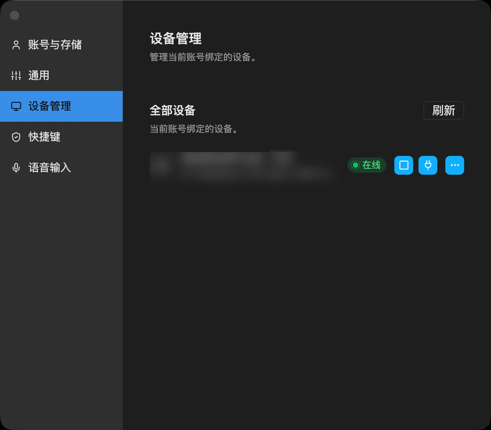

**用户看到什么**：本机卡片（设备名、ID、在线徽标、断开/重新安装/⋯）+ 其他设备行；未关联时有「关联本机 / 认领本机」入口。

**本地能力**：`tunnel:get-status / install-and-start / start / stop` 一组 IPC，安装进度是事件流；安装目录 `~/.isee/tunnel`，脚本 `connect.sh / disconnect.sh / service.sh`，状态机 `NOT_INSTALLED / INCOMPLETE / INSTALLED_NOT_RUNNING / RUNNING / PROTOCOL_MISSING`。

**远端**：`GET /api/auth/install-token`（登录 token 换 2 小时 install-scope token）→ `POST /api/local-agent/register-device`（**必须带 install token**）→ 隧道以设备凭证连云端 WS。移除本机会按 userId 写「不再自动关联」抑制标记，否则下次登录又静默加回来。

**要点**：`connect.sh` 语义是「已在运行则 exit 0」，所以修复后必须 stop → start；macOS TCC 保护目录下 launchd 会恒 126，脚本此时清自身注册并回退前台 nohup。

---

## 16. 设置：快捷键 / 语音输入 / 账号

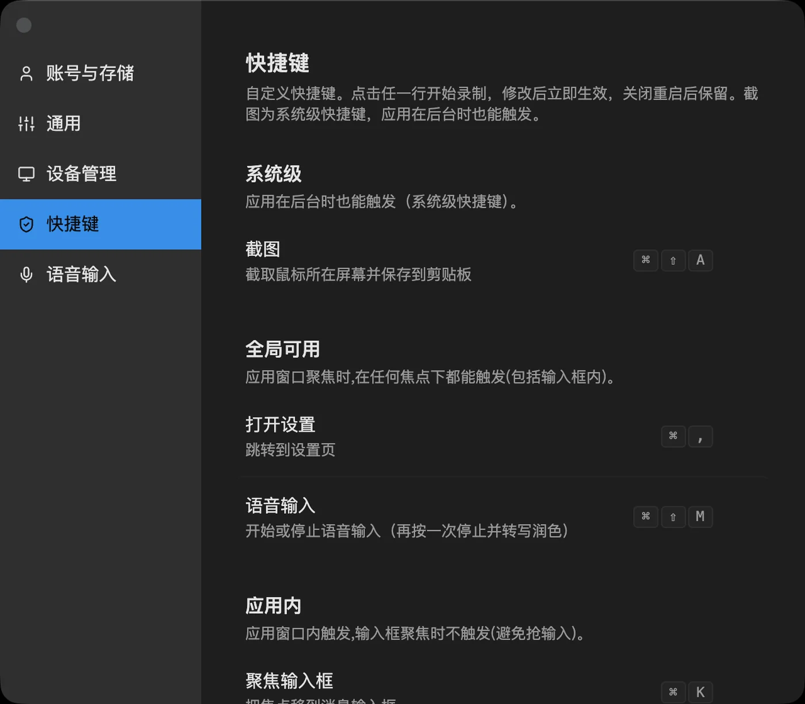

**用户看到什么**：按 scope 分四段（系统级 / 全局 / 应用内 / 仅输入框），点行进录制态、Esc 取消、冲突红字提示、恢复默认；发送键只能选 Enter / Shift+Enter。

**要点**：冲突检测在**主进程**（同加速键被别的 action 占了直接 `{ok:false, reason:"conflict"}`）；录制期间必须挂起系统全局热键，否则按下去会真触发截图。

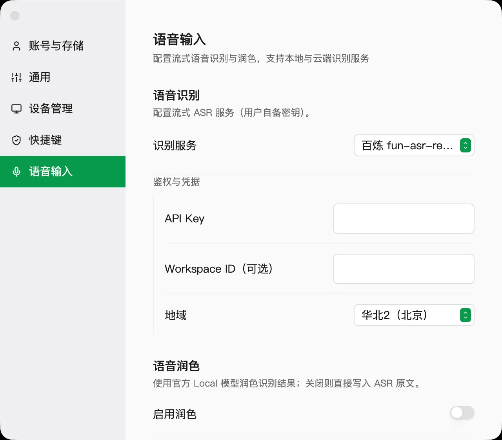

**用户看到什么**：ASR 供应商（百炼 / 火山 / 本地）、凭证表单、本地模型清单（下载/进度/卸载）、润色开关与模型、词典、抑制其他音频。

**本地能力**：凭证用 Electron `safeStorage` 加密后存 `{accountRoot}/credentials/voice-input.json`；本地识别用 `utilityProcess.fork` 拉 sherpa-onnx worker；流式识别结果以 `voice-input:partial` 事件回流，按「冻结 base 草稿 + delta」写回，避免文本堆叠。

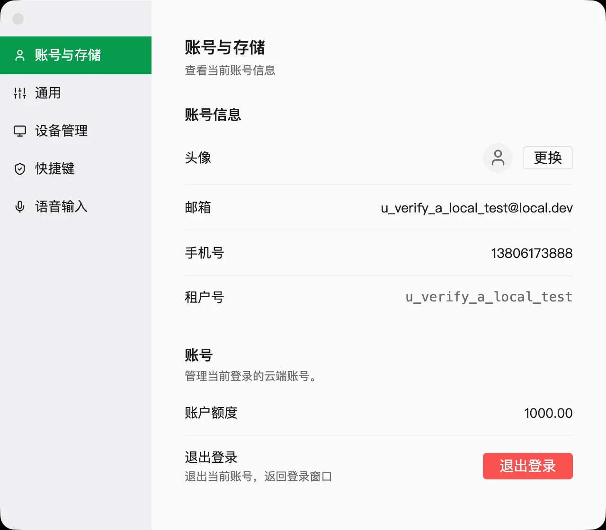

**用户看到什么**：身份卡片（头像/邮箱/手机/租户号）、账号余额、退出登录（带确认）。

**远端**：`GET /api/cloud/auth/me` 是身份唯一权威；头像上传后要双轨刷新（卡片缓存 + 全局 identity store）。

---

## 17. 官网复用评估

结论：**截图 + 结构化功能数据这一层可以直接复用，客户端里的交互（会话、终端、Git、设置写盘）不要照搬。**

| 客户端的东西 | 能否复用到官网 | 理由 |
|---|---|---|
| 12 张真实界面截图 | 直接复用 | 已是 1400px 宽的 webp，单张 14–80KB，`public/features/` 直接静态托管 |
| 功能分组 + 一句话价值 + 三条能力要点 | 直接复用 | 纯数据，落在 `src/data/desktop-features.ts`，与渲染解耦 |
| 分组筛选 + 点击放大看截图 | 直接复用 | 官网唯一的交互需求就是这个；不需要登录、不需要 IPC |
| 主界面四区布局（轨/会话/工作区/面板） | 参考，不要实现 | 真要看起来像客户端，用截图或视频，别在网页里重建一遍排版 |
| 终端（xterm + PTY over WS） | 不复用 | 依赖设备侧 PTY 与云端隧道，官网没有这条链 |
| Git 面板（39 条 IPC + 写锁） | 不复用 | 官网没有本地仓库，也没有 `REPOSITORY_BUSY` 语义要展示 |
| 设置写盘（settings.json + 广播） | 不复用 | 桌面偏好与营销站无关 |
| 主题色 5 预置 | 可选 | 官网有自己的品牌绿，不要为了「像」引入第二套 token |
| Agent 市场卡片网格 | 复用结构，换数据源 | 卡片/分组/详情覆盖层的结构可搬到官网的 Agent 展示页；官网用静态数据，不接 `/api/cloud/agents` |

实现落地见 `apps/isee-china/src/components/Capabilities.tsx` 与 `src/data/desktop-features.ts`：原 `/features` 路由的内容已全量并入首页（及 /agents 页）的「桌面端功能一览」区块，路由本身已移除并 301 到 `/#features`。

页面共 12 张截图。主界面、通讯录、添加菜单这三处的画面已被「Agent 对话 / Agent 资料卡 / Agent 市场」覆盖，没有单独出图，避免同一批界面反复出现。

未做、也不建议在官网做的：实时会话演示、终端模拟、Git 操作回放——这些要么造假，要么需要真后端，都不如直接放一段录屏。

## 复现方式

```bash
# 截图：对运行中的客户端逐面抓图（cua-driver，无需 CDP、无需重启）
cua-driver get_window_state '{"pid":<pid>,"window_id":<id>,"screenshot_out_file":"..."}'

# 官网页面
pnpm dev:isee-china          # 或 pnpm --filter isee-china dev -- -p 3100
open http://localhost:3000/#features
```
